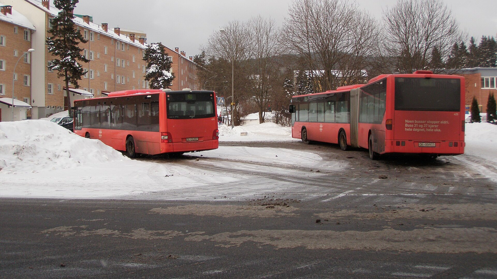
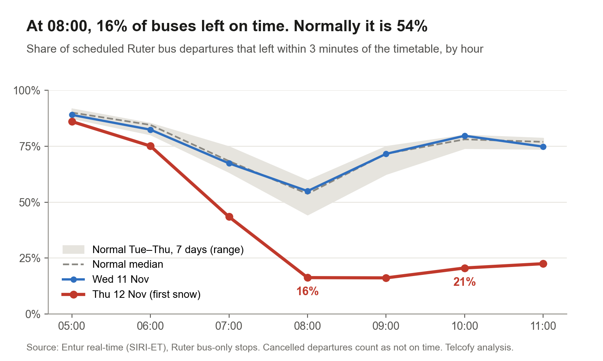
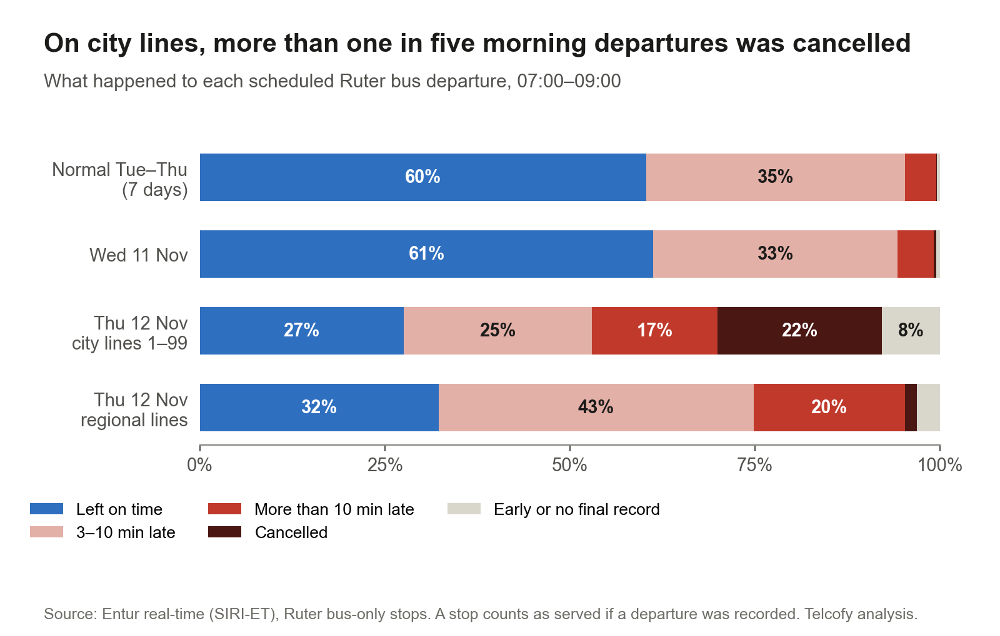
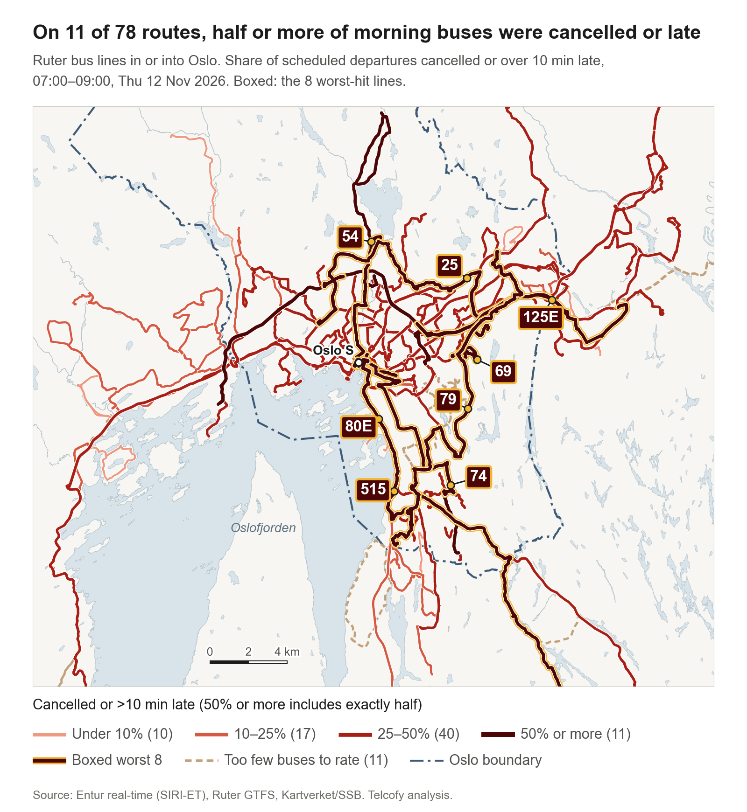

*A file photo, not from 12 November: Tonsenhagen bus stop, February 2011. Photo: [Aslak55](https://commons.wikimedia.org/wiki/File:Tonsenhagen_bussholdeplass,_februar_2011.JPG), [CC BY 3.0](https://creativecommons.org/licenses/by/3.0), via Wikimedia Commons; cropped.*

Thursday 12 November brought the winter's first proper snowfall to Oslo. We compared the morning rush on Ruter's buses with the day before and with seven normal Tuesdays to Thursdays this autumn, using Entur's real-time records.

Between 07:00 and 09:00, 30% of scheduled bus departures left on time. The day before it was 61%, and on a normal day 62%.

<!-- truncate -->

At 08:00, the hardest hour of a normal morning, 16% of buses left within three minutes of the timetable. A normal day gives about 54%, and none of the seven normal days came below 44%. The morning did not recover: at 10:00 and 11:00, 21% and 22% left on time, against 78% and 77% normally.

## City lines were cancelled, regional lines ran late

Across Ruter's area, about one in ten departures between 07:00 and 09:00 never left the stop, against almost none on a normal day. Another 19% left more than ten minutes late, against about 4% normally. The two kinds of line had different mornings. On Oslo's city lines (numbers 1 to 99), 22% of departures were cancelled. Regional lines from Akershus mostly ran, but one in five departures left more than ten minutes late. After 09:00 the cancellations grew, to 42% of all departures between 09:00 and 12:00.

## The worst-hit routes

Of 78 routes in or into Oslo with enough buses to rate, 11 had half or more of their morning departures cancelled or more than ten minutes late. Nine of the 11 are city lines. Ruter told [Aftenposten](https://www.aftenposten.no/norge/i/pM6JEX/mer-enn-halvparten-av-bussavgangene-i-oslo-er-innstilt) that it took buses off some lines because the snowploughs were stuck in the same queues; each of the nine lines it named lost between a fifth and a half of its morning departures to cancellations.

This is one morning, measured against seven normal days. We have not tied it to a weather measurement.

How we know

The data is Entur's real-time archive (SIRI-ET) for Ruter's buses, at Ruter's bus-only stops: 7,037 stops, with metro, tram and ferry stops left out. It covers Ruter's whole area, Oslo and Akershus. We count each scheduled departure from a stop once, by its scheduled hour in Oslo time. There is one record per departure; we found no duplicates.

A departure is on time if it left between 15 seconds early and 3 minutes late. It counts as served if a real departure time was recorded, and as cancelled if it was flagged cancelled and never left. This matters on a day like this. When a bus was taken off the road mid-route, the whole trip was flagged cancelled, although it had already served its first stops; counting the flag alone would put cancellations at 15%, not 10%. Cancelled departures stay in the total, so they count as not on time. Of the buses that did leave, 36% were on time, against 62% normally.

About 5% of the 12 November departures between 07:00 and 09:00 have no final record: most were last predicted to be well over ten minutes late. They count as not on time. If every one of them had been on time, the on-time share would still be only 35%.

The normal range is seven Tuesdays to Thursdays between 27 October and 10 November. The weakest of them, 27 October, had the lowest on-time share (54%) and the most departures more than ten minutes late (10%), and it is kept in the range. The record for Wednesday 11 November is incomplete (some lines are missing, and the 07:00 hour holds about 7% fewer departures than usual), so it is shown for comparison only; its punctuality was normal.

City lines are route numbers 1 to 99, including their E and X variants; regional lines are 100 and up. For the map, a route is "in or into Oslo" if it has at least one stop in Oslo municipality, night buses and rail-replacement buses left out. Each route is rated on all its stops, with at least six trips between 07:00 and 09:00 on 12 November. Routes with fewer are drawn dashed. Each route is drawn along its usual path in Ruter's September 2026 timetable.

Entur's archive loads overnight, so these figures are the day-after record of Thursday morning.

